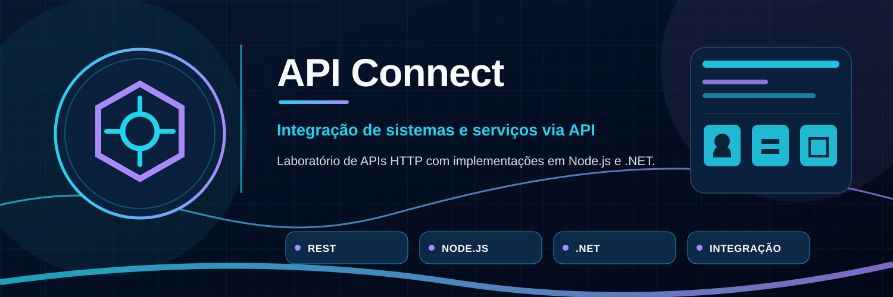
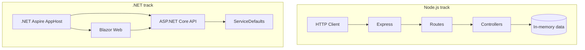

<p align="right"><strong>Language:</strong> <a href="README.md">Português (Brasil)</a> · <a href="README.en.md">English</a></p>

<p align="center"></p>
<p align="center"></p>
<h1 align="center">Api-Connect</h1>
<p align="center"><strong>Comparative backend and HTTP API learning lab.</strong></p>
<p align="center">
  
  
  
  
</p>
<p align="center">
  <a href="https://github.com/RMBarros-Dev/Api-Connect/actions/workflows/ci.yml"></a>
  <a href="https://github.com/RMBarros-Dev/Api-Connect/actions/workflows/codeql.yml"></a>
</p>

## Contents

- [01 · Context and project positioning](#01--context-and-project-positioning)
- [02 · Live demonstration and visual references](#02--live-demonstration-and-visual-references)
- [03 · Features and implementation status](#03--features-and-implementation-status)
- [04 · System architecture](#04--system-architecture)
- [05 · Technology stack](#05--technology-stack)
- [06 · Directory structure](#06--directory-structure)
- [07 · Prerequisites and installation](#07--prerequisites-and-installation)
- [08 · Environment and data configuration](#08--environment-and-data-configuration)
- [09 · User guide](#09--user-guide)
- [10 · Testing and quality](#10--testing-and-quality)
- [11 · Internationalization and localization](#11--internationalization-and-localization)
- [12 · Deployment and infrastructure](#12--deployment-and-infrastructure)
- [13 · Security and limitations](#13--security-and-limitations)
- [14 · Additional documentation](#14--additional-documentation)
- [15 · Contribution, license and credits](#15--contribution-license-and-credits)

## 01 · Context and project positioning

### Overview

Api-Connect is a learning repository containing two independent HTTP service implementations: Node.js/Express and .NET 10 with .NET Aspire. It is a comparative lab, not one hybrid application.

### Purpose and Learning Context

The project explores route design, backend organization, API contracts, HTTP behavior and tooling in different runtimes. The two tracks remain independent so their structures and dependencies can be studied separately.

## 02 · Live demonstration and visual references

The repository does not declare publicly hosted endpoints. Demonstrate it locally by selecting one of the two independent tracks and following the corresponding commands in the user guide.

## 03 · Features and implementation status

The status presented here reflects the scope described in the README and the material referenced by the repository. It is not, by itself, operational sign-off or independent validation.

### Implementation Tracks

| Track | Main components | Purpose |
|---|---|---|
| Node.js | Express, controllers, routes and in-memory data | Demonstrate CRUD-style user endpoints. |
| .NET | ASP.NET Core API, Aspire AppHost, ServiceDefaults and Blazor Web | Demonstrate a coordinated .NET service and web client. |

### Node.js API Routes

| Method | Route | Purpose |
|---|---|---|
| GET | `/` | Check whether the service is responding. |
| GET | `/users` | List users. |
| GET | `/users/:id` | Retrieve a user by identifier. |
| POST | `/users` | Create a user. |
| PUT | `/users/:id` | Replace user data. |
| DELETE | `/users/:id` | Delete a user. |

The JSON body parser is limited to 32 KB. User responses set `Cache-Control: no-store`.

### .NET 10 Service

The .NET solution contains:
- `Api-Connect.ApiService/`: ASP.NET Core service with example routes.
- `Api-Connect.AppHost/`: local startup and orchestration.
- `Api-Connect.ServiceDefaults/`: shared service configuration.
- `Api-Connect.Web/`: Blazor Web application and API client.

The service documents `/` and `/weatherforecast`. OpenAPI mapping is enabled in the development environment.

### Example Request Payload

Example body for `POST /users` in the Express track:

```json
{
  "nome": "Example User",
  "email": "user@example.com",
  "cargo": "Developer"
}
```

Use synthetic data only. The sample payload uses the field names implemented by the demonstration endpoint.

## 04 · System architecture

### Architecture



## 05 · Technology stack

### Technology Stack

| Track | Technologies |
|---|---|
| Node.js | Node.js 18+, npm, Express 4 and JavaScript |
| .NET | .NET 10, ASP.NET Core, .NET Aspire and Blazor |
| API documentation | OpenAPI in the development environment |
| Validation | Repository CI and CodeQL workflows |

## 06 · Directory structure

### Repository Structure

```text
Api-Connect/
├── Api-Connect.ApiService/
├── Api-Connect.AppHost/
├── Api-Connect.ServiceDefaults/
├── Api-Connect.Web/
├── src/
│   ├── controllers/
│   ├── data/
│   ├── middlewares/
│   └── routes/
├── assets/brand/
├── server.js
├── package.json
├── package-lock.json
└── Api-Connect.slnx
```

## 07 · Prerequisites and installation

### Requirements

- Node.js and npm for the Express track.
- .NET 10 SDK for the .NET track.
- .NET Aspire tooling or Visual Studio is optional for the integrated experience.
- Git to clone the repository.

## 08 · Environment and data configuration

This section consolidates the documented configuration and storage information. Sensitive values must be supplied by the runtime environment, never committed.

### Data Storage and Persistence

The Express implementation stores records in memory. Data is lost when the process restarts; this is not durable storage. The .NET track's persistence behavior must be assessed from its own implementation and configuration; do not assume both tracks share a database.

## 09 · User guide

### Run the Node.js Track

From the repository root:

```bash
npm install
npm start
```

The API starts at `http://localhost:3000`. For automatic restart during development:

```bash
npm run dev
```

### Run the .NET Track

From the repository root:

```bash
dotnet restore Api-Connect.slnx
dotnet run --project Api-Connect.AppHost/Api-Connect.AppHost.csproj
```

Use AppHost logs to identify the local service addresses.

## 10 · Testing and quality

### Quality and Validation

Use the repository's CI and CodeQL workflows as automated evidence. Review the exact workflow steps and run the relevant Node.js and .NET builds locally before relying on a result. A green workflow does not establish production readiness.

## 11 · Internationalization and localization

No internationalization/localization pipeline is documented in this repository. Support for languages or regional variants must not be inferred.

## 12 · Deployment and infrastructure

The current documentation does not identify a production provider or published environment. Deployment must be defined and validated before availability is claimed.

## 13 · Security and limitations

### Security and Operational Boundaries

The Express demonstration does not implement authentication or authorization and must not be exposed as a production service. Do not use real personal data. Keep secrets outside version control. Before public exposure, review authentication, authorization, CORS, rate limits, validation and logging.

## 14 · Additional documentation

### Documentation and Engineering Principles

- [Project structure](docs/project-structure.md).
- [Brand guide](docs/brand/README.md).
- [Banner](assets/brand/banner.svg) and [logo](assets/brand/logo.svg).

Preserve clear API contracts, external configuration for secrets, explicit storage boundaries and development-only safeguards.

## 15 · Contribution, license and credits

When proposing changes, describe the goal, affected files and validation performed. Prefer small, reviewable changes; include tests when behavior changes and never submit credentials, tokens or personal data.

### Development Methodology

Keep the Node.js and .NET tracks independent and clearly labeled. Document routes, HTTP methods, payloads and response codes. Use synthetic examples and validate each track with its own runtime and dependencies.

### License and Attribution

See [LICENSE.txt](LICENSE.txt) for the MIT license and applicable terms.
