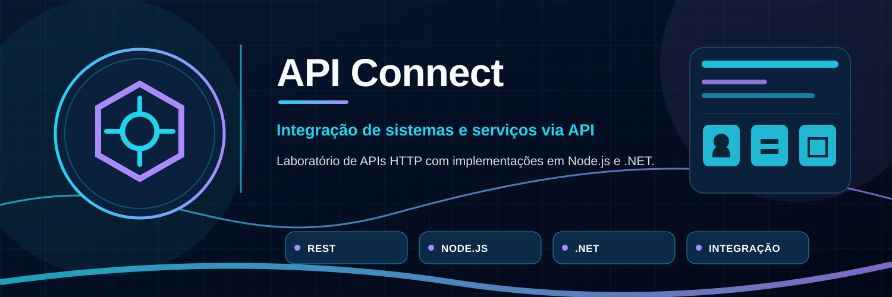
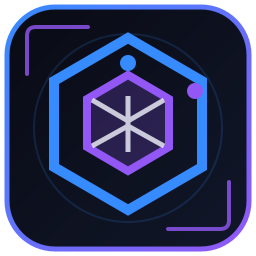
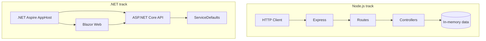

<p align="right"><strong>Language:</strong> <a href="README.pt-BR.md">Português (Brasil)</a> · <a href="README.md">English</a></p>

<p align="center"></p>
<p align="center"></p>
<h1 align="center">Api-Connect</h1>
<p align="center"><strong>Two stacks. One API lab.</strong></p>
<p align="center">A practical comparison of HTTP services, contracts and backend architecture.</p>
<p align="center">
  
  
  
  
</p>
<p align="center">
  <a href="https://github.com/RMBarros-Dev/Api-Connect/actions/workflows/ci.yml"></a>
  <a href="https://github.com/RMBarros-Dev/Api-Connect/actions/workflows/codeql.yml"></a>
</p>

## Contents

- [01 · Overview](#01--overview)
- [02 · Purpose and Learning Context](#02--purpose-and-learning-context)
- [03 · Implementation Tracks](#03--implementation-tracks)
- [04 · Node.js API Routes](#04--nodejs-api-routes)
- [05 · .NET 10 Service](#05--net-10-service)
- [06 · Architecture](#06--architecture)
- [07 · Technology Stack](#07--technology-stack)
- [08 · Requirements](#08--requirements)
- [09 · Run the Node.js Track](#09--run-the-nodejs-track)
- [10 · Run the .NET Track](#10--run-the-net-track)
- [11 · Example Request Payload](#11--example-request-payload)
- [12 · Data Storage and Persistence](#12--data-storage-and-persistence)
- [13 · Security and Operational Boundaries](#13--security-and-operational-boundaries)
- [14 · Quality and Validation](#14--quality-and-validation)
- [15 · Repository Structure](#15--repository-structure)
- [16 · Development Methodology](#16--development-methodology)
- [17 · Documentation and Engineering Principles](#17--documentation-and-engineering-principles)
- [18 · License and Attribution](#18--license-and-attribution)

## 01 · Overview

Api-Connect is a learning repository containing two independent HTTP service implementations: Node.js/Express and .NET 10 with .NET Aspire. It is a comparative lab, not one hybrid application.

## 02 · Purpose and Learning Context

The project explores route design, backend organization, API contracts, HTTP behavior and tooling in different runtimes. The two tracks remain independent so their structures and dependencies can be studied separately.

## 03 · Implementation Tracks

| Track | Main components | Purpose |
|---|---|---|
| Node.js | Express, controllers, routes and in-memory data | Demonstrate CRUD-style user endpoints. |
| .NET | ASP.NET Core API, Aspire AppHost, ServiceDefaults and Blazor Web | Demonstrate a coordinated .NET service and web client. |

## 04 · Node.js API Routes

| Method | Route | Purpose |
|---|---|---|
| GET | `/` | Check whether the service is responding. |
| GET | `/users` | List users. |
| GET | `/users/:id` | Retrieve a user by identifier. |
| POST | `/users` | Create a user. |
| PUT | `/users/:id` | Replace user data. |
| DELETE | `/users/:id` | Delete a user. |

The JSON body parser is limited to 32 KB. User responses set `Cache-Control: no-store`.

## 05 · .NET 10 Service

The .NET solution contains:
- `Api-Connect.ApiService/`: ASP.NET Core service with example routes.
- `Api-Connect.AppHost/`: local startup and orchestration.
- `Api-Connect.ServiceDefaults/`: shared service configuration.
- `Api-Connect.Web/`: Blazor Web application and API client.

The service documents `/` and `/weatherforecast`. OpenAPI mapping is enabled in the development environment.

## 06 · Architecture



## 07 · Technology Stack

| Track | Technologies |
|---|---|
| Node.js | Node.js 18+, npm, Express 5 and JavaScript |
| .NET | .NET 10, ASP.NET Core, .NET Aspire and Blazor |
| API documentation | OpenAPI in the development environment |
| Validation | Repository CI and CodeQL workflows |

## 08 · Requirements

- Node.js and npm for the Express track.
- .NET 10 SDK for the .NET track.
- .NET Aspire tooling or Visual Studio is optional for the integrated experience.
- Git to clone the repository.

## 09 · Run the Node.js Track

From the repository root:

```bash
npm install
npm start
```

The API starts at `http://localhost:3000`. For automatic restart during development:

```bash
npm run dev
```

## 10 · Run the .NET Track

From the repository root:

```bash
dotnet restore Api-Connect.slnx
dotnet run --project Api-Connect.AppHost/Api-Connect.AppHost.csproj
```

Use AppHost logs to identify the local service addresses.

## 11 · Example Request Payload

Example body for `POST /users` in the Express track:

```json
{
  "nome": "Example User",
  "email": "user@example.com",
  "cargo": "Developer"
}
```

Use synthetic data only. The sample payload uses the field names implemented by the demonstration endpoint.

## 12 · Data Storage and Persistence

The Express implementation stores records in memory. Data is lost when the process restarts; this is not durable storage. The .NET track's persistence behavior must be assessed from its own implementation and configuration; do not assume both tracks share a database.

## 13 · Security and Operational Boundaries

The Express demonstration does not implement authentication or authorization and must not be exposed as a production service. Do not use real personal data. Keep secrets outside version control. Before public exposure, review authentication, authorization, CORS, rate limits, validation and logging.

## 14 · Quality and Validation

Use the repository's CI and CodeQL workflows as automated evidence. Review the exact workflow steps and run the relevant Node.js and .NET builds locally before relying on a result. A green workflow does not establish production readiness.

## 15 · Repository Structure

```text
Api-Connect/
├── Api-Connect.ApiService/
├── Api-Connect.AppHost/
├── Api-Connect.ServiceDefaults/
├── Api-Connect.Web/
├── src/
│   ├── controllers/
│   ├── data/
│   ├── middlewares/
│   └── routes/
├── assets/brand/
├── server.js
├── package.json
├── package-lock.json
└── Api-Connect.slnx
```

## 16 · Development Methodology

Keep the Node.js and .NET tracks independent and clearly labeled. Document routes, HTTP methods, payloads and response codes. Use synthetic examples and validate each track with its own runtime and dependencies.

## 17 · Documentation and Engineering Principles

- [Project structure](docs/project-structure.md).
- [Brand guide](docs/brand/README.md).
- [Banner](assets/brand/banner.svg) and [logo](assets/brand/logo.svg).

Preserve clear API contracts, external configuration for secrets, explicit storage boundaries and development-only safeguards.

## 18 · License and Attribution

See [LICENSE.txt](LICENSE.txt) for the MIT license and applicable terms.


## Engineering Metrics

<div align="center">
  
  
  
  
</div>

<!-- REPOSITORY_METRICS_START -->
### Language distribution (GitHub Linguist)


| Language | Source bytes | Share |
|---|---:|---:|
| JavaScript | 9,141 | 29.30% |
| C# | 8,675 | 27.81% |
| CSS | 7,754 | 24.85% |
| HTML | 5,629 | 18.04% |

_Total measured source bytes: 31,199. Refreshed: 2026-11-22 12:38 UTC._

<!-- REPOSITORY_METRICS_END -->

### Technical verification

| Dimension | Implemented evidence | Measurement boundary |
|---|---|---|
| Node.js track | JavaScript, Node.js 18+, Express 5 | Independent HTTP service; records are stored in memory and lost on restart. |
| .NET track | C#, .NET 10, ASP.NET Core, Blazor Web and .NET Aspire | Separate solution track; not a shared hybrid runtime. |
| API documentation | OpenAPI enabled in the .NET development environment | Does not imply a published production API contract. |
| Input / response handling | Express JSON body limit and no-store response header are documented | Not a substitute for authentication, authorization or full threat mitigation. |
| Automated tests | No test count or coverage percentage asserted in this summary | Verify actual test projects and workflow steps before claiming coverage. |
| CI | [CI workflow](.github/workflows/ci.yml) | Current result is shown by the workflow badge above. |
| Static security analysis | [CodeQL workflow](.github/workflows/codeql.yml) | Workflow execution is not a security certification. |
| Security boundary | Express track has no authentication or authorization | Demonstration only; do not expose as a production service. |
