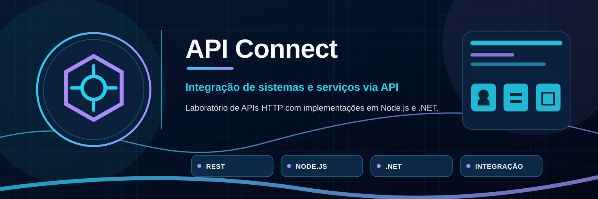
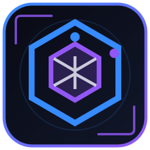
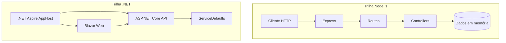

<p align="right"><strong>Idioma:</strong> <a href="README.pt-BR.md">Português (Brasil)</a> · <a href="README.md">English</a></p>

<p align="center"></p>
<p align="center"></p>
<h1 align="center">Api-Connect</h1>
<p align="center"><strong>Duas stacks. Um laboratório de APIs.</strong></p>
<p align="center">Comparação prática de serviços HTTP, contratos e arquitetura backend.</p>
<p align="center">
  
  
  
  
  <a href="https://github.com/RMBarros-Dev/Api-Connect/actions/workflows/ci.yml"></a>
  <a href="https://github.com/RMBarros-Dev/Api-Connect/actions/workflows/codeql.yml"></a>
</p>

## Índice

- [01 · Visão geral](#01--visão-geral)
- [02 · Objetivo e contexto](#02--objetivo-e-contexto)
- [03 · Trilhas de implementação](#03--trilhas-de-implementação)
- [04 · Rotas Node.js e Express](#04--rotas-nodejs-e-express)
- [05 · Serviço .NET 10](#05--serviço-net-10)
- [06 · Arquitetura](#06--arquitetura)
- [07 · Tecnologias](#07--tecnologias)
- [08 · Requisitos](#08--requisitos)
- [09 · Executar a trilha Node.js](#09--executar-a-trilha-nodejs)
- [10 · Executar a trilha .NET](#10--executar-a-trilha-net)
- [11 · Exemplo de payload](#11--exemplo-de-payload)
- [12 · Persistência e dados](#12--persistência-e-dados)
- [13 · Segurança e limites operacionais](#13--segurança-e-limites-operacionais)
- [14 · Qualidade e validação](#14--qualidade-e-validação)
- [15 · Estrutura do repositório](#15--estrutura-do-repositório)
- [16 · Metodologia de desenvolvimento](#16--metodologia-de-desenvolvimento)
- [17 · Documentação e princípios](#17--documentação-e-princípios)
- [18 · Licença e atribuição](#18--licença-e-atribuição)

## 01 · Visão geral

O Api-Connect reúne duas implementações independentes de serviços HTTP: Node.js/Express e .NET 10 com .NET Aspire. É um laboratório comparativo, não uma única aplicação híbrida.

## 02 · Objetivo e contexto

O projeto explora desenho de rotas, organização backend, contratos de API, comportamento HTTP e ferramentas de runtimes distintos. As duas trilhas permanecem separadas para permitir estudo e comparação sem misturar dependências.

## 03 · Trilhas de implementação

| Trilha | Componentes principais | Objetivo |
|---|---|---|
| Node.js | Express, controllers, routes e dados em memória | Demonstrar endpoints CRUD de usuários. |
| .NET | ASP.NET Core API, Aspire AppHost, ServiceDefaults e Blazor Web | Demonstrar serviço .NET e cliente web coordenados. |

## 04 · Rotas Node.js e Express

| Método | Rota | Finalidade |
|---|---|---|
| GET | `/` | Verificar se o serviço responde. |
| GET | `/users` | Listar usuários. |
| GET | `/users/:id` | Consultar usuário por identificador. |
| POST | `/users` | Cadastrar usuário. |
| PUT | `/users/:id` | Substituir dados do usuário. |
| DELETE | `/users/:id` | Remover usuário. |

O parser JSON limita o corpo a 32 KB. As respostas de usuários definem `Cache-Control: no-store`.

## 05 · Serviço .NET 10

A solução .NET contém:
- `Api-Connect.ApiService/`: serviço ASP.NET Core com rotas de exemplo.
- `Api-Connect.AppHost/`: inicialização e orquestração local.
- `Api-Connect.ServiceDefaults/`: configurações compartilhadas.
- `Api-Connect.Web/`: aplicação Blazor Web e cliente da API.

O serviço documenta as rotas `/` e `/weatherforecast`. O mapeamento OpenAPI está habilitado no ambiente de desenvolvimento.

## 06 · Arquitetura



## 07 · Tecnologias

| Trilha | Tecnologias |
|---|---|
| Node.js | Node.js 18+, npm, Express 5 e JavaScript |
| .NET | .NET 10, ASP.NET Core, .NET Aspire e Blazor |
| Documentação de API | OpenAPI no ambiente de desenvolvimento |
| Validação | Workflows de CI e CodeQL do repositório |

## 08 · Requisitos

- Node.js e npm para a trilha Express.
- SDK do .NET 10 para a trilha .NET.
- Ferramentas .NET Aspire ou Visual Studio são opcionais para a experiência integrada.
- Git para clonar o repositório.

## 09 · Executar a trilha Node.js

Na raiz do repositório:

```bash
npm install
npm start
```

A API inicia em `http://localhost:3000`. Para reinicialização automática durante o desenvolvimento:

```bash
npm run dev
```

## 10 · Executar a trilha .NET

Na raiz do repositório:

```bash
dotnet restore Api-Connect.slnx
dotnet run --project Api-Connect.AppHost/Api-Connect.AppHost.csproj
```

Consulte os logs do AppHost para identificar os endereços locais dos serviços.

## 11 · Exemplo de payload

Exemplo de corpo para `POST /users` na trilha Express:

```json
{
  "nome": "Usuário de Exemplo",
  "email": "usuario@example.com",
  "cargo": "Desenvolvedor"
}
```

Utilize somente dados sintéticos. Os nomes dos campos seguem o contrato da rota demonstrativa.

## 12 · Persistência e dados

A implementação Express mantém os registros em memória. Os dados são perdidos quando o processo reinicia; não se trata de persistência durável. O comportamento de armazenamento da trilha .NET deve ser verificado em sua própria implementação e configuração; não presuma que as duas trilhas compartilham um banco.

## 13 · Segurança e limites operacionais

A API demonstrativa Express não implementa autenticação ou autorização e não deve ser exposta como serviço de produção. Não utilize dados pessoais reais. Mantenha segredos fora do controle de versão. Antes de qualquer exposição pública, revise autenticação, autorização, CORS, limites de requisição, validação e logs.

## 14 · Qualidade e validação

Os workflows de CI e CodeQL são evidências automatizadas dos controles que efetivamente executam. Revise as etapas dos workflows e execute os builds Node.js e .NET localmente antes de depender dos resultados. Um workflow verde não comprova prontidão para produção.

## 15 · Estrutura do repositório

```text
Api-Connect/
├── Api-Connect.ApiService/
├── Api-Connect.AppHost/
├── Api-Connect.ServiceDefaults/
├── Api-Connect.Web/
├── src/
│   ├── controllers/
│   ├── data/
│   ├── middlewares/
│   └── routes/
├── assets/brand/
├── server.js
├── package.json
├── package-lock.json
└── Api-Connect.slnx
```

## 16 · Metodologia de desenvolvimento

Mantenha as trilhas Node.js e .NET independentes e claramente identificadas. Documente rotas, métodos HTTP, payloads e códigos de resposta. Utilize exemplos sintéticos e valide cada trilha com seu próprio runtime e dependências.

## 17 · Documentação e princípios

- [Organização de arquivos](docs/project-structure.md).
- [Identidade visual](docs/brand/README.md).
- [Banner SVG](assets/brand/banner.svg) e [logotipo SVG](assets/brand/logo.svg).

Preserve contratos de API claros, configuração externa de segredos, limites explícitos de armazenamento e salvaguardas para ambientes de desenvolvimento.

## 18 · Licença e atribuição

Consulte [LICENSE.txt](LICENSE.txt) para a licença MIT e seus termos aplicáveis.


## Métricas de Engenharia

<div align="center">
  
  
  
  
</div>

<!-- REPOSITORY_METRICS_START -->
### Distribuição de linguagens (GitHub Linguist)


| Linguagem | Bytes de código | Participação |
|---|---:|---:|
| JavaScript | 9,141 | 29.30% |
| C# | 8,675 | 27.81% |
| CSS | 7,754 | 24.85% |
| HTML | 5,629 | 18.04% |

_Total de bytes de código contabilizados: 31,199. Atualizado em: 2026-11-28 13:07 UTC._

<!-- REPOSITORY_METRICS_END -->

### Verificação técnica

| Dimensão | Evidência implementada | Limite da medição |
|---|---|---|
| Frente Node.js | JavaScript, Node.js 18+, Express 5 | Serviço HTTP independente; registros ficam em memória e são perdidos ao reiniciar. |
| Frente .NET | C#, .NET 10, ASP.NET Core, Blazor Web e .NET Aspire | Frente de solução separada; não é um runtime híbrido compartilhado. |
| Documentação de API | OpenAPI habilitado no ambiente de desenvolvimento .NET | Não implica contrato de API publicado em produção. |
| Entrada / resposta | Limite do corpo JSON do Express e cabeçalho no-store documentados | Não substitui autenticação, autorização ou mitigação completa de ameaças. |
| Testes automatizados | Este resumo não declara quantidade de testes ou percentual de cobertura | Verificar projetos de teste e etapas do workflow antes de declarar cobertura. |
| CI | [Workflow de CI](.github/workflows/ci.yml) | Resultado atual indicado pelo badge acima. |
| Análise estática de segurança | [Workflow CodeQL](.github/workflows/codeql.yml) | Execução do workflow não equivale a certificação de segurança. |
| Limite de segurança | A frente Express não possui autenticação ou autorização | Uso demonstrativo; não expor como serviço de produção. |
