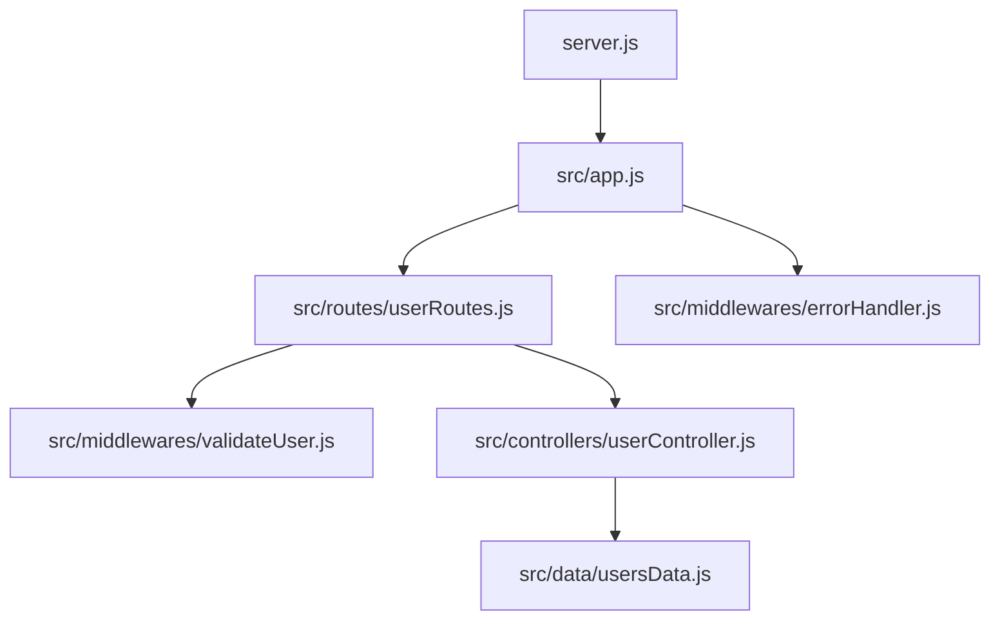
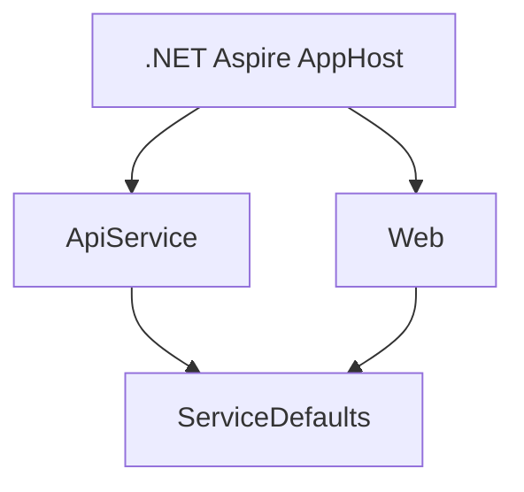

# Arquitetura do Api-Connect

## Visão geral

Mantenho duas trilhas de estudo no mesmo repositório, mas as trato como implementações independentes: uma API Node.js/Express e uma solução .NET 10 com .NET Aspire.

## Trilha Node.js / Express

Organizo a API Express da seguinte forma:

Os dados de usuários desta implementação são mantidos em memória no módulo `src/data/usersData.js`. Portanto, não trato essa implementação como persistência durável.

## Trilha .NET Aspire

A solução .NET possui os projetos `Api-Connect.ApiService`, `Api-Connect.AppHost`, `Api-Connect.ServiceDefaults` e `Api-Connect.Web`.

## Qualidade

O workflow executa testes HTTP na implementação Express, verifica sintaxe JavaScript e restaura/compila a solução .NET.

## Limites de escopo

As duas trilhas não compartilham automaticamente estado ou persistência. Eu documento seus comportamentos de forma separada e não apresento a API Express em memória como equivalente de uma API com banco persistente.

## Referências

- [README](../../README.md)
- [Política de segurança](../../SECURITY.md)
- [Contribuição](../../CONTRIBUTING.md)
- [Decisão arquitetural atual](../decisions/0001-current-architecture.md)
